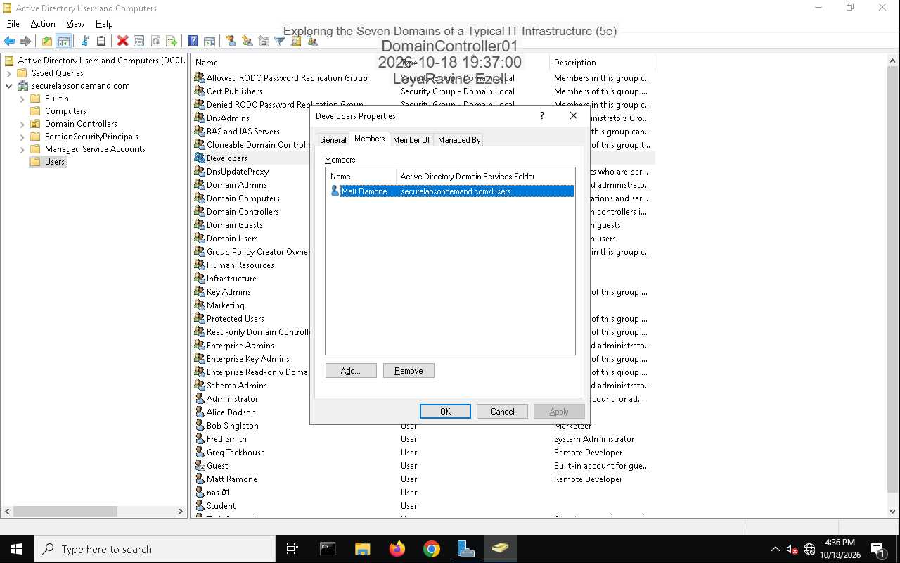
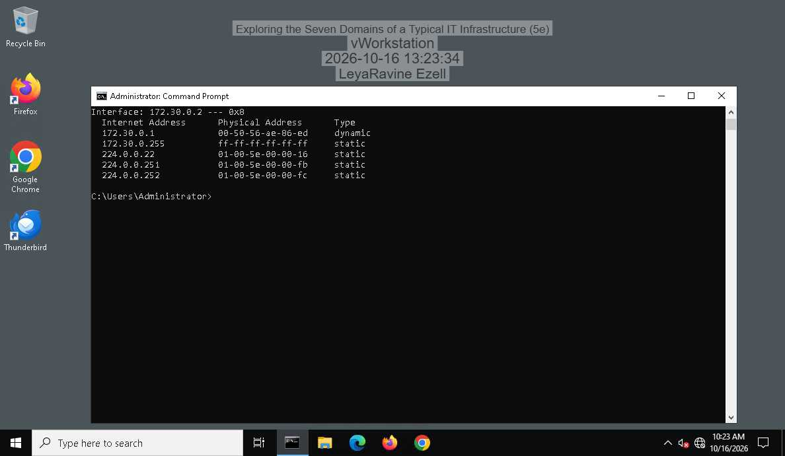
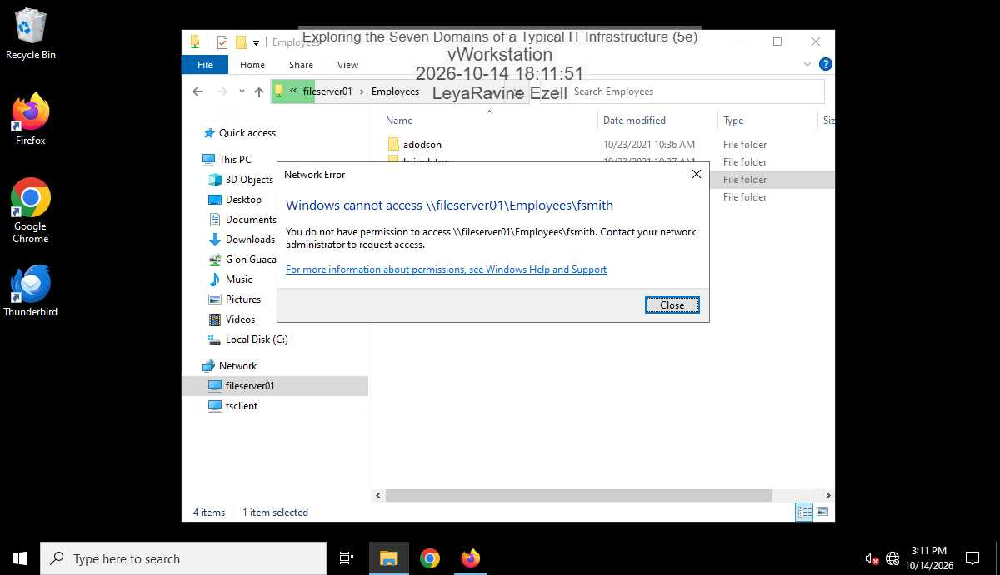
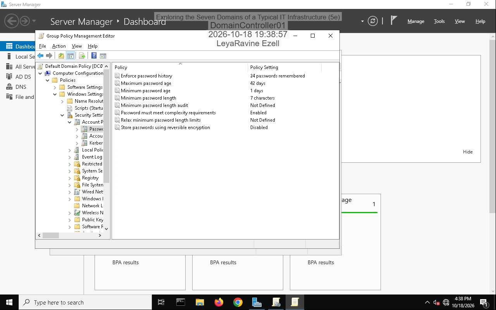
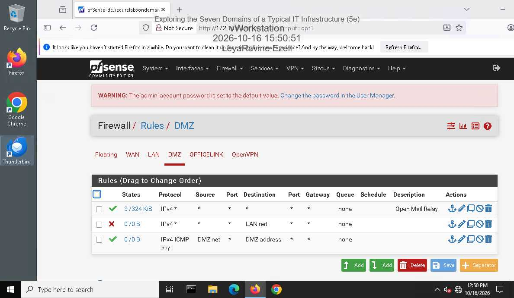
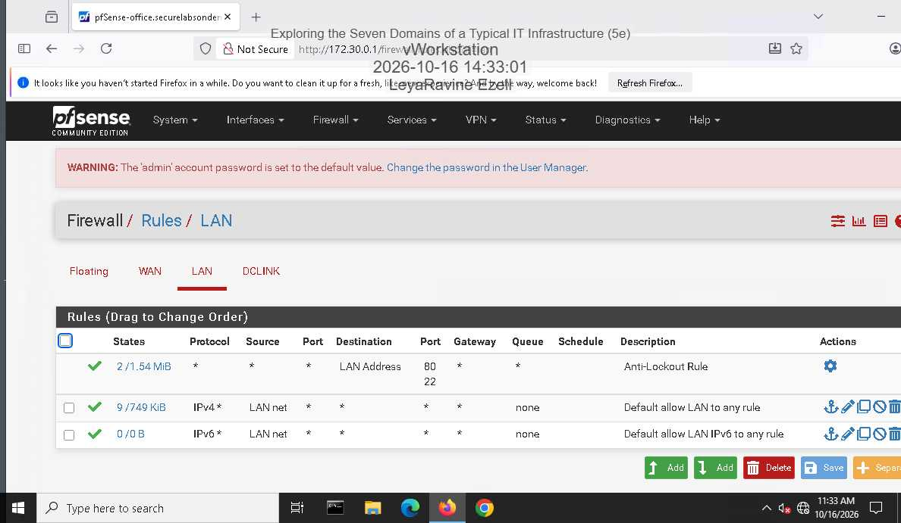

Enterprise Network Security & Access Control Investigation
WGU Cybersecurity Lab | November 2026 | Simulated educational environment
Overview- I explored how security controls protect different parts of an organization’s IT infrastructure. I examined Windows security settings, shared-folder access, Active Directory groups, network connections, and pfSense firewall configurations.

Tools and concepts- Windows, Windows Server, Active Directory, Group Policy, pfSense, traceroute, ARP, DNS, NAT, VPN routing, firewall rules, file permissions.

Investigations- Windows security and access. Reviewed sign-in settings, threat protection, and successful versus denied access to user and shared folders.

Network and firewall- Inspected ARP and forwarding tables, listening sockets, static routes, pfSense NAT and firewall rules, port forwarding, and DMZ rules.

Identity and authentication- Reviewed current-user identity, Active Directory Developers group membership, and Group Policy password settings.

Remote access- Used traceroute results to examine network paths and explored VPN split/full tunneling. The tunneling classification requires additional verification of the paths before publication.

Security recommendations- For a simulated credential-compromise scenario, recommended EDR, network segmentation, next-generation firewall/intrusion prevention, and phishing-resistant MFA. These were recommendations, not deployed controls.

SOC relevance- This lab developed my foundation in examining network behavior, reviewing security configurations, validating access restrictions, and documenting technical findings. It was not a production SOC investigation.

Evidence to add- (1) Sanitized screenshots of successful and denied shared- folder access (report p.3) (2) Sanitized pfSense firewall/NAT screenshots (report pp.6-7) (3) Sanitized Active Directory and Group Policy screenshots (report pp. 9-10) (4) Verified routing analysis with annotated traceroute evidence

Lessons learned- Firewalls, endpoint protection, network segmentation, and access controls each protect different parts of a system. Checking actual command results and permissions matters before drawing conclusions.

## Lab Evidence & Screenshots

### Active Directory Group Membership

In this lab, I reviewed the members of an Active Directory security group. This helped me understand how organizations manage user access and why group membership is important for security.

### Network Investigation — ARP Table

I examined the ARP table to see how devices on a local network associate IP addresses with physical MAC addresses. This helped me better understand network communication and how to use command-line information when troubleshooting connectivity.

### Windows File Access Permissions

I attempted to access a user folder and observed that the connection was denied. This showed me how access restrictions help prevent users from opening resources they are not authorized to access.

### Windows Group Policy Password Settings

I reviewed password policy settings through the Group Policy Management Console. This helped me understand how organizations manage account security requirements in a Windows environment.

### pfSense DMZ Firewall Rules

I examined the firewall rules for a demilitarized zone (DMZ) to better understand how organizations control traffic between network segments and protect systems that may need external access.

### pfSense LAN Firewall Rules

I reviewed the LAN firewall rules in pfSense to understand how traffic is allowed or restricted based on security policies. This helped me connect firewall configurations to network protection.

## How This Project Relates to Security Operations

This lab helped me understand how different parts of a network work together and how security controls help protect them.

I practiced investigating network connections, reviewing firewall rules, checking user permissions, and examining Windows security settings.

These are foundational skills I can build on in a Security Operations Center (SOC), where analysts investigate suspicious activity, review security alerts, document findings, and help protect company systems.

This project was completed in a simulated lab environment as part of my cybersecurity coursework.
